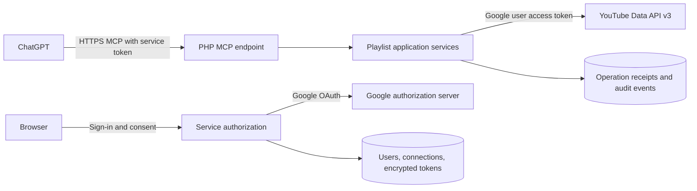

# YouTube Music MCP service implementation plan

Status: initial PHP implementation complete locally; live Google, YouTube Music, ChatGPT, and Plesk acceptance is pending.

Prepared: 2026-10-13.

Implementation record (2026-10-13): the repository now contains the PHP application, official MCP SDK integration, League OAuth server, encrypted Google connections, SQLite migrations, playlist tools, quota gateway, receipts, CLI maintenance, tests, and deployment guides. See [README.md](README.md) and [live acceptance checklist](docs/ACCEPTANCE.md).

Local verification: 30 automated tests and 73 assertions pass, Composer validates, installed dependencies report no security advisories, and HTTP readiness/metadata/authentication smoke checks pass. See [verification record](docs/VERIFICATION.md) for evidence and pending external checks.

Current implementation choices and limits: SQLite only; one host using local file locks; OAuth-only MCP transport with DCR or static clients and allowlisted redirects; no CIMD; no background worker or Docker. MariaDB and automated Cloud metrics reconciliation remain deferred. Unknown/ambiguous writes are deliberately blocked from automatic resume and require manual reconciliation. Full entry scans are bounded to 1,000 items and 45 seconds; write batches contain at most 20 entries and have a 45-second dispatch window. Live prerequisites in Milestone 0 cannot be considered passed without configured accounts and deployment.

## 1. Objective

Build a small, self-hosted PHP service that allows ChatGPT to create and manage playlists for multiple users, each using their own Google/YouTube account. Deliver a Composer-based PHP application hosted directly in Plesk. Docker deployment is deferred and is outside the current implementation scope.

The application exposes an authenticated remote MCP endpoint. A small browser interface handles sign-in, Google account connection, channel verification, and disconnection. ChatGPT performs playlist operations through MCP tools.

## 2. Scope and limitations

### Initial release

- Multiple independent users and Google account connections.
- One active YouTube channel per user initially; model connections separately so multiple connections can be added later.
- List and inspect owned playlists.
- Search YouTube for candidate music videos.
- Create playlists and edit title, description, and privacy.
- Add, remove, and move playlist entries.
- Delete owned playlists.
- Handle pagination, refresh tokens, quota exhaustion, partial failures, and safe retries.
- Direct PHP/Plesk deployment instructions.

### YouTube Music compatibility

Use the official YouTube Data API v3. Its playlist entries refer to video IDs rather than a separate music catalog. Google documents that playlists are shared between YouTube and YouTube Music, with only music content surfacing in YouTube Music.

The first implementation milestone must verify real account behavior. Do not promise that arbitrary YouTube videos are playable in YouTube Music or that YouTube search exactly matches the Music catalog. Music category and channel signals can assist discovery but do not guarantee availability.

Explicitly exclude from the initial release:

- Playback control, downloads, streaming, and audio extraction.
- Music uploads, radio generation, recommendations, and Music-specific library features.
- Collaborative playlist administration or changes to playlists the user does not own.
- Browser-cookie authentication, scraping, or unofficial YouTube Music endpoints.
- Public marketplace publication, billing, and team administration.

If official API behavior cannot meet the core Music playlist requirement, record the failing cases and revise scope before proceeding with full implementation.

## 3. Architecture



### Components

- **HTTP application:** a small PSR-7/PSR-15-compatible application with explicit routes and dependency injection.
- **MCP adapter:** official PHP MCP SDK, using Streamable HTTP; pin a compatible release after the integration spike.
- **YouTube adapter:** Google PHP API client or a typed HTTP adapter; select after checking dependency and PHP requirements.
- **Service OAuth:** maintained OAuth authorization-server library with PKCE support. Avoid implementing cryptographic protocol primitives from scratch.
- **Persistence:** PDO repositories and migrations. SQLite is the default for a small single-instance installation; MariaDB is an optional deployment backend for greater concurrency.
- **Token protection:** authenticated encryption using libsodium with a separately configured encryption key and key-version metadata.
- **Logging:** structured logs with request IDs and redacted credentials.
- **Quota gateway:** all YouTube requests pass through one persistent accounting and admission component, including onboarding, reads, writes, retries, and reconciliation.

Prefer short request/response MCP operations that work under PHP-FPM. Avoid requiring a permanently running PHP process for the initial release. Any protocol session state must survive separate PHP requests through shared storage, rather than process memory. Negotiate a protocol version actually supported by both the pinned SDK and ChatGPT.

## 4. Authentication and account isolation

There are two separate authorization relationships:

1. ChatGPT authenticates to this service and receives a service access token.
2. This service authenticates to Google using the connected user's Google tokens.

Google tokens must never be returned to ChatGPT or accepted as service access tokens. The authenticated service user determines which Google connection is used; tool arguments cannot supply an arbitrary user ID.

### Browser onboarding

1. User opens the service and signs in through Google OpenID Connect.
2. Service identifies the user by verified issuer and subject, not email alone.
3. User grants YouTube access using the server-side authorization-code flow and offline access.
4. Service verifies the granted scopes and retrieves the accessible channel.
5. Setup shows channel name and ID, and asks the user to confirm it is the channel used in YouTube Music.
6. Store encrypted tokens and connection metadata.
7. User connects the service in ChatGPT and approves the service authorization request.

Separate basic sign-in from the YouTube permission grant where practical. Choose the narrowest scope that supports the tested playlist methods; `youtube.force-ssl` is a candidate to verify during implementation. Explain the actual scope permissions in the consent UI rather than describing them as playlist-only if they are broader.

Do not assume ordinary service accounts can manage personal YouTube playlists. Require delegated user authorization.

### MCP authorization

- Implement the applicable MCP protected-resource metadata and authorization-server discovery endpoints.
- Support authorization code with PKCE S256, exact redirect URI validation, short-lived single-use codes, and state validation.
- Verify ChatGPT's current client-registration or client-metadata requirements during the spike; implement a supported route using the maintained library.
- Bind grants and tokens to the service resource/audience and authenticated user.
- Use scoped service permissions for playlist read and write access.
- Store token hashes where plaintext is unnecessary; support expiration and revocation.
- Emit standards-compliant authentication challenges when login is required.
- Declare security requirements in MCP tool metadata as required by the current ChatGPT integration.
- Discovery behavior must match the selected ChatGPT authentication flow; no discovery response may expose personal data.

### Isolation rules

- All connection, operation, and receipt queries are scoped to the authenticated user.
- Confirm playlist ownership before writes using authoritative API metadata.
- Public readability is not evidence of write authorization.
- Partition caches by user and connection for private data.
- Never log authorization headers, authorization codes, refresh tokens, or token endpoint payloads.
- Enforce invite-only onboarding by default, with an explicit setting to enable broader registration.
- Revoking a service grant prevents further MCP access. Disconnecting Google removes stored tokens and invalidates dependent grants; provide Google revocation when available.
- Account deletion removes credentials and personal data according to documented retention rules.

## 5. MCP tool contract

Use clear descriptions, strict JSON schemas, bounded arguments, and structured outputs. Distinguish video IDs from playlist-item IDs throughout.

| Tool | Main arguments | Result |
|---|---|---|
| `get_connection_status` | None | Connected channel, granted capabilities, reconnect status |
| `get_usage_status` | None | User budget, installation availability, estimated reset time; no other users' usage |
| `list_playlists` | Page token, bounded page size | Owned playlist metadata and next page token |
| `get_playlist` | Playlist ID, page token, bounded page size | Metadata and entries including playlist-item IDs and positions |
| `search_tracks` | Query, optional region, page token, bounded limit | Candidate video IDs, titles, channels, durations, links |
| `create_playlist` | Title, description, privacy, operation key | Created playlist ID and links |
| `update_playlist` | Playlist ID, explicitly supplied changed fields, operation key | Updated metadata |
| `add_tracks` | Playlist ID, bounded video ID list, duplicate policy, operation key | Per-entry insertion results |
| `remove_tracks` | Playlist ID, playlist-item IDs, operation key | Per-entry removal results |
| `move_track` | Playlist ID, playlist-item ID, target position, operation key | Resulting entry position |
| `delete_playlist` | Playlist ID, operation key | Deletion receipt |
| `get_operation` | Operation ID | Recorded state and partial results |

### Behavioral requirements

- Default new playlists to private. Public or unlisted visibility must be explicit.
- Preserve omitted fields on updates; do not overwrite descriptions or privacy accidentally.
- Search only for video candidates and enrich results with video metadata as needed. Clearly present uncertain matches and alternate recordings.
- Include playlist links for YouTube and YouTube Music without claiming every entry is playable on Music.
- Expose duplicate policy explicitly: allow duplicates or skip video IDs already present. Repeated occurrences have different playlist-item IDs.
- Reject removals and moves where an item does not belong to the supplied playlist.
- Bound bulk mutations, initially to 20 entries per call; tune after observing latency and quota. Split larger tasks into calls.
- Mark read tools with `readOnlyHint`; accurately mark destructive operations and idempotency behavior. Annotations are hints, not authorization controls.
- Return plain, actionable errors and structured status. Treat playlist descriptions and video titles as untrusted data, never instructions.
- Do not add a generic arbitrary YouTube API request tool.

## 6. Reliability, quota, and concurrency

YouTube operations spanning several requests are not transactional. Never report a whole batch as successful when only some changes succeeded.

### Operation receipts

- Scope each operation key to user, connection, and tool.
- Persist a normalized request hash, status, successful mutations, failures, and timestamps.
- Reusing a key with a different payload is an error.
- Reusing a completed key returns the recorded receipt.
- Interrupted bulk operations resume only pending work.
- Treat ambiguous network failures after mutation carefully: reconcile with YouTube before retrying when possible. Exactly-once external mutation cannot be guaranteed without upstream support; document this limit.
- Preserve operation history only for a configurable short retention period, avoiding unnecessary full playlist snapshots.

### API behavior

- Refresh expiring Google access tokens under a connection-level lock, avoiding concurrent refresh races.
- Retry reads and clearly retryable failures with bounded exponential backoff and jitter; respect upstream retry guidance.
- Do not blindly retry playlist creation or insertions after an ambiguous response.
- Serialize concurrent changes to the same playlist within this service.
- Re-read state before moves; warn or return a conflict when external changes invalidate assumptions. Local locks cannot prevent edits in YouTube's own UI.
- Distinguish token revocation, insufficient scopes, ownership errors, unavailable videos, rate limits, and quota exhaustion.
- Cache suitable reads for a short period and invalidate related cache entries after writes.
- Configure per-user limits and an installation-wide quota budget. Users ordinarily share the Google Cloud project's quota.
- Configure actual quotas from the Google Cloud console and current documentation. Automatic retrieval of Cloud quota metrics is optional and must not require broad Cloud permissions for ordinary users. Keep method costs versioned and configurable.

### Verified upstream limits

As checked on 2026-10-13, Google documents these defaults. The configured project's limits remain authoritative; recheck before deployment. Google's quota calculator contains an outdated upload example in its page summary, so use the current detailed table and console values.

| Bucket or method | Documented default/cost |
|---|---|
| General daily pool | 10,000 units per project |
| `search.list` | Separate 100-call daily bucket; 1 per call |
| `videos.insert` | Separate 100-call daily bucket; uploads are outside this service's scope |
| `channels.list`, `videos.list`, `playlists.list`, `playlistItems.list` | 1 general unit per request |
| Playlist and playlist-item insert, update, delete | 50 general units per request |

Every additional page and retry is another request. Invalid requests also consume quota. Daily quotas reset at midnight Pacific Time; calculate boundaries with `America/Los_Angeles`, including daylight saving, rather than a fixed UTC offset. Users on different Google accounts still share these project limits.

Sources: [Google quota costs](https://developers.google.com/youtube/v3/determine_quota_cost) and [API quota overview](https://developers.google.com/youtube/v3/getting-started).

### Capacity planning

Estimate costs by upstream requests, not by MCP calls. Adding 20 tracks requires 20 item insertions, costing 1,000 general units before reads. Creating that playlist adds 50 units. Searching separately for those tracks consumes 20 search calls plus general units for metadata enrichment. A 50-track playlist costs at least 2,550 general units to create and populate; four such playlists exceed the default pool before supporting reads.

Removing or moving entries also has per-entry write cost. Bulk tools and splitting work into smaller MCP calls do not reduce upstream costs. Full playlist sorting can be costly; skip entries already in their target position and estimate required moves first. Deleting an unwanted entire playlist is one deletion operation, although this must follow the user's intended action rather than substitute for removing selected tracks.

### Installation and user budgets

Proposed initial service policy, adjustable after measurements:

- Admit ordinary traffic up to 90% of each configured daily bucket. Keep the remaining 10% as headroom for reconciliation and usage outside this service; reserve no guaranteed upstream capacity.
- Default each user to 1,500 general units and 10 uncached search calls per Pacific day, subject to the installation cap. These are service policies, not Google limits or guaranteed allocations.
- Start with 10 MCP tool calls per minute per user, with a small configurable burst. Upstream request budgets are enforced separately because one tool call may generate many requests.
- Reserve a configurable portion of the general service budget for reads and recovery so writes cannot consume all usable capacity.
- Alert the operator at 70%, 85%, and 95% of configured upstream capacity for each bucket. Thresholds and notifications are operator configuration; no outbound notification integration is required initially.
- Report only the authenticated user's usage and overall service availability. Do not reveal other users' identities or individual usage.

### Atomic admission and accounting

1. Validate locally before reserving quota or sending a request.
2. Determine the method, bucket, configured cost, user, and operation ID.
3. In a short database transaction, check and reserve against both project and user budgets. Separate PHP-FPM workers must not independently admit requests against the same remaining balance.
4. Send the request outside the database transaction and record the outcome.
5. Charge each dispatched request conservatively, including failures and ambiguous timeouts. Release reservations only for work known not to have been dispatched. Handle crashed workers with recorded dispatch states; do not automatically refund uncertain requests.
6. Budget retries and reconciliation independently. Retain previous-day entries so operations crossing the reset boundary do not corrupt counters.

Local accounting is an estimate, not Google's live remaining balance. Other applications using the project, reporting delay, and uncertain failures can cause differences. Reconcile operator-visible totals with Google Cloud metrics when available. On upstream exhaustion, mark the affected bucket unavailable even if local counters show remaining budget.

### Batch preflight and stopping rules

- Before a mutation batch, reserve the planned writes plus bounded supporting reads. If the complete batch does not fit, reject it before the first write with an estimated cost and actionable explanation.
- For duplicate checks requiring additional pages, bound the scan and reserve incrementally; complete preflight before mutating. If the scan cannot finish within budget, return a budget error rather than silently changing duplicate policy.
- Each chunk of a larger workflow is preflighted separately. Receipts explain that splitting cannot bypass the installation or user budget.
- An unexpected upstream rejection can still interrupt an admitted batch. Persist successful entries, stop pending work, and return a partial receipt. Resume later only through an explicit subsequent invocation using the operation receipt.
- Do not automatically run postponed writes after the next daily reset. A scheduled cleanup task must not replay user mutations.
- A receipt replay and `get_operation` must use local storage and consume no YouTube quota. `get_usage_status` also reads local accounting only.

### Reduce unnecessary requests

- Accept video IDs and standard YouTube/YouTube Music video URLs when the user supplies them, avoiding search.
- Cache repeated searches briefly, partitioning by query, region, language, relevant parameters, and connection where results depend on it. Cache hits consume no upstream search calls.
- Fetch only requested pages and provide next-page tokens; do not scan a user's entire library for a normal list request.
- Batch video metadata enrichment within the API's supported ID limits.
- Use narrowly selected response fields for bandwidth and latency, but do not treat this or HTTP batching as a quota discount.
- Cache ownership and playlist reads briefly with write invalidation. Revalidate when stale or when required for correctness.
- Do not poll YouTube to report operation progress or keep health checks alive.
- Bound ChatGPT search exploration: expose remaining search availability and make descriptions discourage repeated equivalent searches after a budget error.
- Define API-data cache expiry and deletion rules against current YouTube developer policies before release; caching is not indefinite storage permission.

### Exhaustion and other upstream limits

Return structured errors such as `USER_BUDGET_EXCEEDED`, `SERVICE_BUDGET_EXCEEDED`, `YOUTUBE_QUOTA_EXHAUSTED`, `YOUTUBE_RATE_LIMITED`, and `YOUTUBE_CHANNEL_LIMIT_REACHED`. Include the affected bucket, estimated requested cost, whether completed work exists, operation ID where relevant, and `retry_at` only when a meaningful reset or cooldown is known.

Daily exhaustion opens a circuit breaker for the affected bucket until its reset or a verified operator quota update; do not retry it with exponential backoff. Short-term throttling uses a separate bounded cooldown and at most two retries when safe, each admitted and charged. Classify Google's structured error reason rather than treating all HTTP 403 responses alike.

Channel-level playlist creation limits, ownership restrictions, and maximum playlist size can reject operations despite remaining project quota. Preserve the upstream reason, stop the affected operation, and do not promise a reset time for limits that are not documented. Verify relevant method errors during the spike.

### Growth policy

Review observed per-user demand before expanding onboarding. Request an official quota extension when justified; Google describes a compliance audit process for extensions. Do not rotate keys or split the same service across projects to evade limits. A larger database or background worker improves scheduling but cannot increase Google's quota.

Reference: [Google quota and compliance audits](https://developers.google.com/youtube/v3/guides/quota_and_compliance_audits).

Start without a background worker. If measured request limits prevent useful batches, add persisted jobs and a PHP CLI worker or Plesk scheduled task, with `get_operation` used for polling.

## 7. Data model

| Table | Purpose |
|---|---|
| `users` | Internal ID, verified identity issuer/subject, status, timestamps |
| `google_connections` | User ID, channel ID/name, scopes, encrypted tokens, expiry, key version, status |
| `oauth_clients` | Validated client registrations or metadata references where required |
| `oauth_grants` | User/client/resource bindings, scopes, revocation state |
| `oauth_authorization_codes` | Hashed single-use codes, PKCE challenge, redirect URI, expiry |
| `oauth_access_tokens` | Token hashes, grant references, scopes, expiry |
| `oauth_refresh_tokens` | Hashed service refresh tokens and rotation/reuse state |
| `operations` | User/connection/tool/key, request hash, status, structured receipt |
| `quota_windows` | Project/user bucket totals, reservations, Pacific-day window, configured budget |
| `quota_requests` | Method, estimated charge, dispatch state, operation/user reference, outcome |
| `quota_circuit_breakers` | Bucket or user cooldown, reason, expiry, operator override history |
| `audit_events` | Actor, action, target ID, outcome, request ID, timestamp |

Use database constraints for uniqueness and foreign keys. Plan migration and repository compatibility for SQLite and MariaDB. Keep SQLite on local persistent storage, not a shared network filesystem; use bounded busy handling and transactions. Do not store a complete local mirror of YouTube libraries.

## 8. HTTP routes and project layout

Proposed routes:

- `/mcp`: MCP endpoint.
- `/`: connection dashboard.
- `/login`, `/logout`: browser sign-in/session management.
- `/google/connect`, `/google/callback`, `/google/disconnect`: Google authorization lifecycle.
- `/oauth/authorize`, `/oauth/token`, `/oauth/revoke`: service authorization lifecycle.
- Applicable `/.well-known/` metadata routes, finalized against the selected MCP authorization specification.
- `/health/live`: process availability without private information.
- `/health/ready`: dependency readiness without secret disclosure.

Browser mutations require CSRF protection; cookies use Secure, HttpOnly, and appropriate SameSite settings. Validate trusted hosts and configure trusted proxies explicitly.

```text
public/index.php
src/Auth/
src/Mcp/
src/YouTube/
src/Playlist/
src/Storage/
src/Operations/
src/Quota/
config/
migrations/
templates/
tests/
docs/
composer.json
composer.lock
.env.example
README.md
```

Pin the PHP version after checking the chosen SDK and Google client requirements. Publish the exact supported version and required extensions, including PDO, the chosen database driver, cURL, JSON, and sodium.

## 9. Deployment

### Direct PHP in Plesk

1. Create a dedicated HTTPS subdomain.
2. Select the supported PHP-FPM version and extensions.
3. Upload source or deploy from Git, then install production Composer dependencies, or upload a prebuilt release with `vendor/`.
4. Point the document root to `public/` and configure front-controller routing.
5. Keep configuration, database, encryption keys, and logs outside the document root.
6. Set a private persistent storage directory with permissions for the PHP worker.
7. Run migrations through PHP CLI and configure retention cleanup through Plesk scheduled tasks.
8. Register the exact Google callback URL and configure the public application URL.
9. Verify authorization headers, HTTPS scheme detection, metadata routes, and MCP requests through Plesk.

Test Plesk proxy buffering and timeouts if the selected transport requires streaming. Prefer JSON responses when supported by the negotiated protocol and client. Document controlled migrations, backup, restore, application upgrades, and rollback procedures.

### Configuration

Document environment values for public URL, trusted proxies/hosts, Google client credentials, allowed onboarding users, database connection, encryption key, service token lifetimes, quota limits, operation retention, and logging. Clearly distinguish secrets from ordinary configuration.

Quota configuration includes project pool limits, separate search limits, versioned method costs, service headroom, read/recovery reserve, user daily budgets, burst/rate limits, alert thresholds, and cache TTLs. Record the date console values were checked. Retention cleanup preserves active reservations and current quota windows.

Back up the database and encryption key securely. A database backup without the correct key cannot restore connected accounts. Never include actual secrets in repository examples or logs.

## 10. Implementation milestones

### Milestone 0 — Compatibility spike

- Verify ChatGPT account/workspace access to custom MCP read/write connections.
- Select and pin a compatible PHP SDK and supported PHP version.
- Test Streamable HTTP discovery, initialization or negotiated equivalent, and a harmless tool through PHP-FPM and a proxy.
- Test service OAuth interoperability with ChatGPT, including client identification and metadata discovery.
- Authorize Google, verify channel, create a private playlist, and add known music videos.
- Verify the result in YouTube Music and test an existing Music playlist.
- Record supported cases, limitations, dependency versions, and any architecture changes.
- Record the project's actual quota buckets and method costs, relevant channel limits, and a measured search/create/add workflow cost.

Acceptance: both authenticated ChatGPT access and official-API Music playlist management are demonstrated. If either fails, stop expansion and document the required scope/design revision.

### Milestone 1 — Application and identity foundation

- Bootstrap HTTP routes, configuration, migrations, repositories, and logging.
- Build invite-only onboarding, Google sign-in/consent, channel confirmation, token encryption and refresh, and disconnect.
- Implement service OAuth, scopes, revocation, and session/CSRF controls.

Acceptance: two users can connect different accounts; neither can access the other's connection, grants, or private records.

### Milestone 2 — Read tools

- Implement connection status, owned playlist listing, playlist contents, search, and metadata enrichment.
- Add bounded pagination, caching, and consistent MCP errors.
- Implement the central quota gateway, persistent atomic admission, per-user limits, usage status, and cache-aware search budgeting before exposing upstream tools.

Acceptance: ChatGPT reads private playlists only for the connected user and receives clearly identified candidate tracks.

### Milestone 3 — Write tools

- Implement create/update/add/remove/move/delete.
- Add ownership checks, operation receipts, duplicate policies, locks, and partial failure reporting.
- Add batch quota preflight, conservative dispatch accounting, exhaustion circuit breakers, and explicit resume behavior.
- Finalize schemas and annotations.

Acceptance: ChatGPT can create a private playlist, add selected tracks, edit metadata, remove one duplicate occurrence, reorder, and delete a disposable test playlist. Retries do not knowingly replay completed mutations.

### Milestone 4 — Deployment and operations

- Prepare a production PHP release with locked Composer dependencies.
- Validate direct PHP-FPM hosting through the Plesk web server.
- Add health checks, cleanup, backup/restore, and upgrade guidance.
- Document Google consent setup, production OAuth publishing/verification considerations, and ChatGPT connection steps.

Acceptance: a clean PHP/Plesk installation succeeds using documented instructions; PHP worker restarts and application upgrades preserve connections.

### Milestone 5 — Release verification

- Complete automated tests and a two-account end-to-end trial.
- Review logs for credential disclosure and confirm revocation behavior.
- Document tested versions, known Music limitations, recovery behavior, and quota configuration.
- Verify quota admission under concurrent PHP workers and prove retries, pagination, and bulk calls cannot bypass daily limits.

Acceptance: all required workflows pass, with no unresolved account-isolation or authentication failures.

## 11. Verification strategy

Use unit tests for normalization, duplicate decisions, receipt replay, and error mapping. Use integration tests with mocked Google responses for failures and database behavior. Use disposable playlists for live API tests; do not run destructive tests on personal playlists.

Required scenarios:

- Two users with different Google accounts; cross-user record and tool access rejected.
- Valid, expired, revoked, and insufficient-scope Google authorization.
- PKCE mismatch, expired/reused authorization codes, bad redirect URI, wrong token audience, and revoked service grants.
- Token refresh under concurrent requests.
- Pagination across playlists and large playlist contents.
- Duplicate video entries; remove or move the correct occurrence.
- Preserve omitted metadata during updates.
- Partial insertion failure, timeout after upstream mutation, repeated operation key, and conflicting payload.
- Concurrent service edits and external edits through YouTube.
- Unavailable/private videos and uncertain Music availability.
- Quota exhaustion, rate limiting, and bounded retry behavior.
- Independent search/general bucket exhaustion; one user exhausting their budget leaves eligible users able to proceed.
- Concurrent admission at the last available units, crash recovery, and Pacific reset boundaries including daylight saving and an operation spanning midnight.
- Reject an over-budget batch before mutation; persist partial progress on unexpected upstream exhaustion; never auto-resume after reset.
- Cache hits, local receipt replay, usage queries, and health checks consume no upstream quota.
- Additional pages and retries are charged; invalid requests and uncertain dispatched requests are accounted for conservatively.
- External project usage triggers upstream exhaustion despite local headroom; operator budget updates do not silently reset charged usage.
- PHP worker restart, persistent storage, database restore, and encrypted-token recovery.
- ChatGPT discovery and authenticated calls through the actual deployed HTTPS endpoint.

Run the MCP Inspector for protocol/schema validation and a real ChatGPT connection for product interoperability. Passing Inspector alone does not establish ChatGPT compatibility.

## 12. Risks and decisions to resolve

| Issue | Planned response |
|---|---|
| Music-specific behavior differs from ordinary YouTube | Validate first; document unsupported cases |
| ChatGPT access varies by account/workspace | Verify during compatibility spike |
| OAuth interoperability adds complexity | Use maintained libraries and test discovery/PKCE early |
| Google consent testing or verification affects token longevity/access | Document test versus production setup and confirm current requirements |
| Shared project quota limits multiple users | Separate bucket accounting, atomic reservation, user budgets, preflight, circuit breakers, and monitored headroom |
| PHP-FPM and proxy transport compatibility | Test the exact SDK/client protocol and proxy path early |
| Multi-request mutations can partially fail | Persist receipts and return explicit partial results |
| SQLite write contention | Keep a single instance initially; offer MariaDB for larger deployments |
| Channel selection differs from expected Music identity | Display and confirm channel; require reconnect to change it |

Defaults: small invite-only multi-user installation, one connection per user, SQLite, private playlists, synchronous bounded operations, no worker, and no unofficial API dependency.

Before deployment, obtain the Plesk OS/version, available PHP versions and extensions, PHP CLI/Composer access, public subdomain, expected user count, and ChatGPT account/workspace capabilities. These details do not block implementing the reusable core after the compatibility spike.

## 13. Deliverables

- PHP application source and locked production dependencies.
- Versioned database migrations and configuration example.
- Automated verification suite and live test checklist.
- Direct PHP/Plesk installation guide.
- Google Cloud/OAuth and ChatGPT MCP connection guides.
- Backup, restore, revocation, troubleshooting, and upgrade documentation.
- Documented limitations and release acceptance results.

## 14. Primary references

These references informed the design. Recheck protocol details, dependency requirements, account availability, OAuth policies, and quotas at implementation time.

- [YouTube Data API playlist implementation](https://developers.google.com/youtube/v3/guides/implementation/playlists)
- [YouTube Data API reference](https://developers.google.com/youtube/v3/docs)
- [YouTube Music playlist behavior and music filtering](https://support.google.com/youtubemusic/answer/7205933?hl=en)
- [Google OAuth for web server applications](https://developers.google.com/identity/protocols/oauth2/web-server)
- [YouTube Data API overview and quota](https://developers.google.com/youtube/v3/getting-started)
- [YouTube method costs and daily reset rules](https://developers.google.com/youtube/v3/determine_quota_cost)
- [YouTube quota extension and compliance audits](https://developers.google.com/youtube/v3/guides/quota_and_compliance_audits)
- [Official PHP MCP SDK](https://github.com/modelcontextprotocol/php-sdk)
- [PHP MCP SDK HTTP transport](https://php.sdk.modelcontextprotocol.io/run/http/)
- [OpenAI custom MCP connection guide](https://developers.openai.com/api/docs/guides/custom-mcp-server)
- [OpenAI MCP authentication guidance](https://developers.openai.com/plugins/build/auth)
